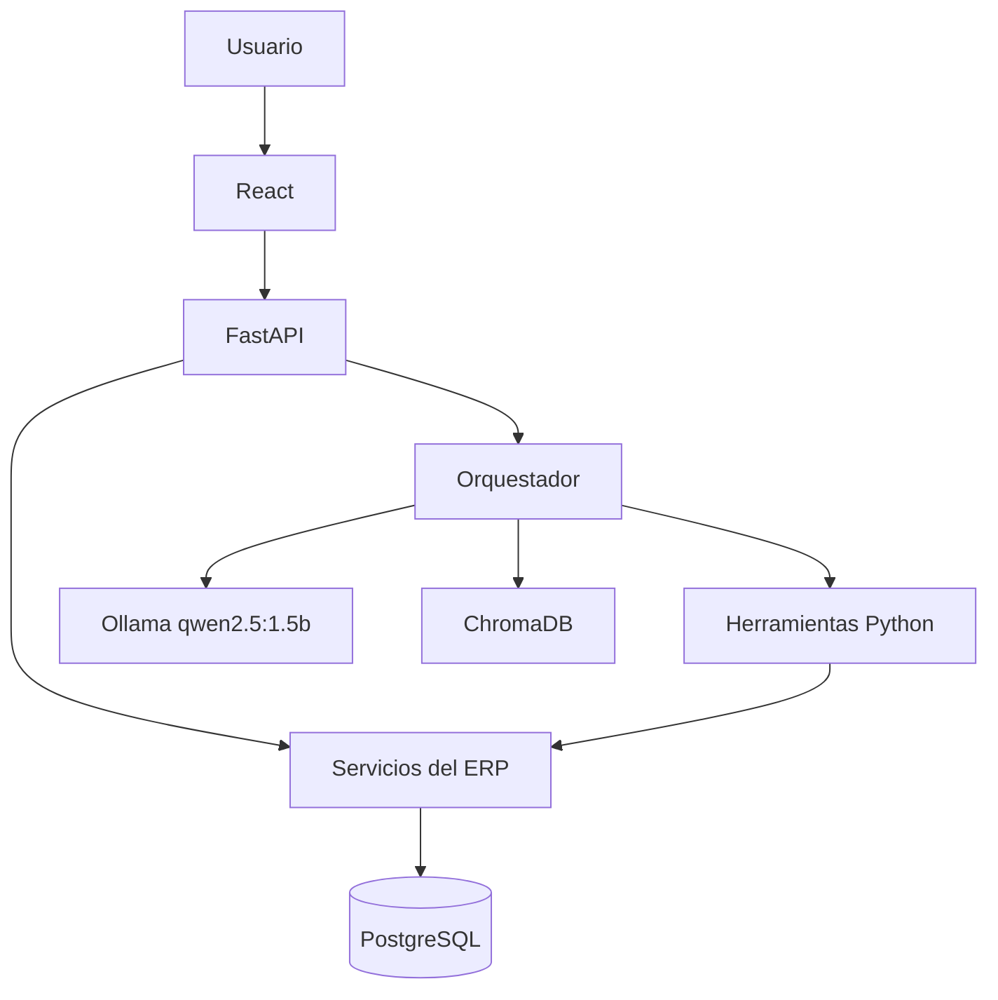
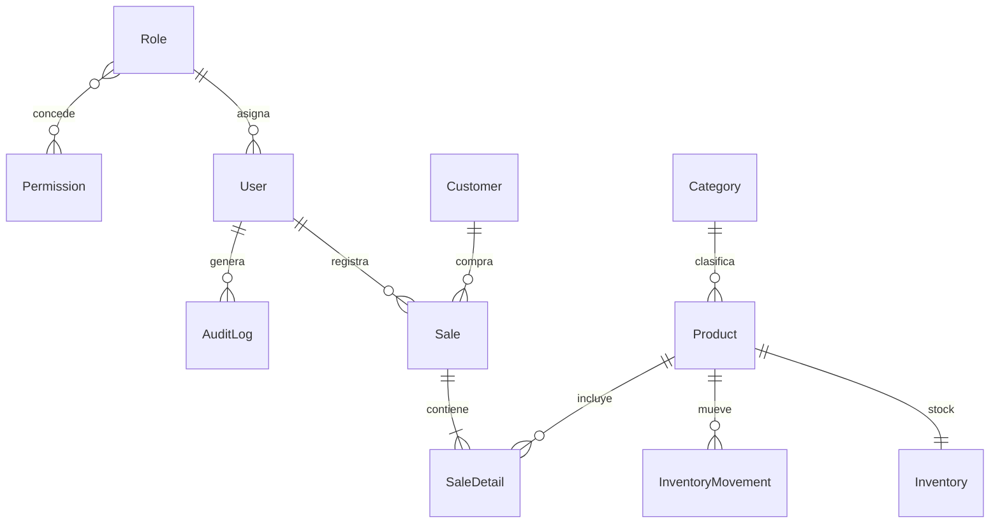
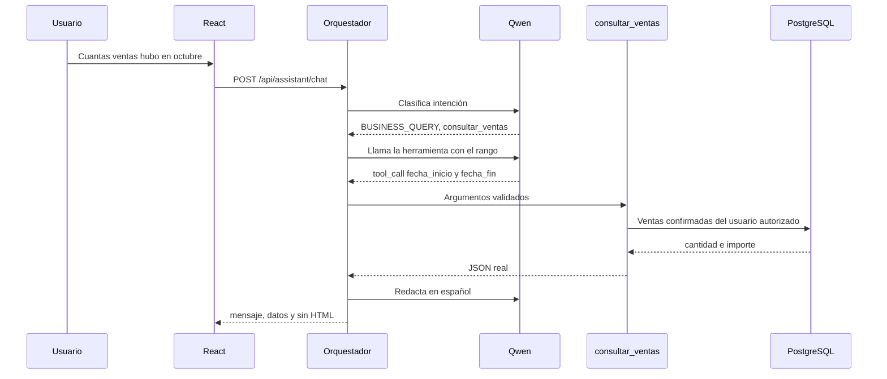

# Arquitectura

Intelligent ERP es un monolito modular. El frontend, la API, la base de datos y el asistente se despliegan en la misma máquina. No hay microservicios, Docker ni APIs de pago.

## Vista general

Si Ollama no responde, los módulos de clientes, productos, inventario y ventas siguen disponibles. El chat explica que el asistente no está disponible.

## Frontend

React y TypeScript, empaquetados con Vite. React Router define las pantallas. El token JWT vive en `sessionStorage`. Las llamadas usan `fetch` contra `/api`, y Vite reenvía ese prefijo al puerto 8000.

El asistente es un panel fijo. Muestra el texto, botones de navegación y tablas. Una ruta solo se abre si está en la lista blanca del frontend, además de haber salido del catálogo del backend. El mensaje del modelo se pinta como texto, nunca como HTML.

## Backend

FastAPI organiza las rutas por módulo. Pydantic valida la entrada. SQLAlchemy habla con PostgreSQL y Alembic versiona el esquema. Las reglas de venta, stock y permisos están en `backend/app/services`. Las consultas reutilizables están en `backend/app/repositories`.

## Base de datos

Una venta confirmada y sus movimientos de inventario se graban en la misma transacción. Si falta stock, se revierte todo.

## Seguridad

La contraseña se guarda con Argon2 mediante pwdlib. Passlib no se usa porque su última versión falla con las librerías actuales de hash en Python 3.12. El JWT incluye el identificador del usuario y un `token_version`. Desactivar al usuario o cambiar su contraseña aumenta esa versión y deja inválidos los tokens viejos.

Cada ruta protegida declara el permiso que exige. El asistente vuelve a comprobar el permiso dentro de la herramienta. El modelo no elige qué datos puede ver.

## Integración de IA

`ai_orchestrator.py` recibe el mensaje y la identidad ya autenticada.

1. Rechaza borrados masivos y la consulta de ventas de todos los vendedores cuando el rol no tiene `sales.read_all`.
2. Pregunta a Qwen la intención y la herramienta, en JSON.
3. Pide una llamada real de herramienta de Ollama, con un solo esquema para que el modelo de 1.5B acierte.
4. `tool_executor.py` valida los argumentos con Pydantic y llama a un servicio Python.
5. Qwen redacta la respuesta. Si escribe un número que no está en el resultado, se reemplaza por una frase armada con ese resultado.
6. La memoria guarda los últimos ocho mensajes de la sesión y no sustituye los permisos.

Las operaciones `crear_*` no se ejecutan en la primera llamada. Quedan pendientes diez minutos y solo el botón Confirmar, ligado al mismo usuario, las graba.

## Flujo de una consulta de ventas

## Perfil de 8 GB sin GPU

`OLLAMA_NUM_CTX` queda en 2048. El chat usa `keep_alive` de 10 minutos. Los embeddings usan `keep_alive` 0 para no convivir con el modelo de chat. PostgreSQL de esta máquina no se reconfigura; en una PC de 8 GB conviene un `shared_buffers` bajo, del orden de 128 MB, dejado a criterio de quien administra ese servidor.
